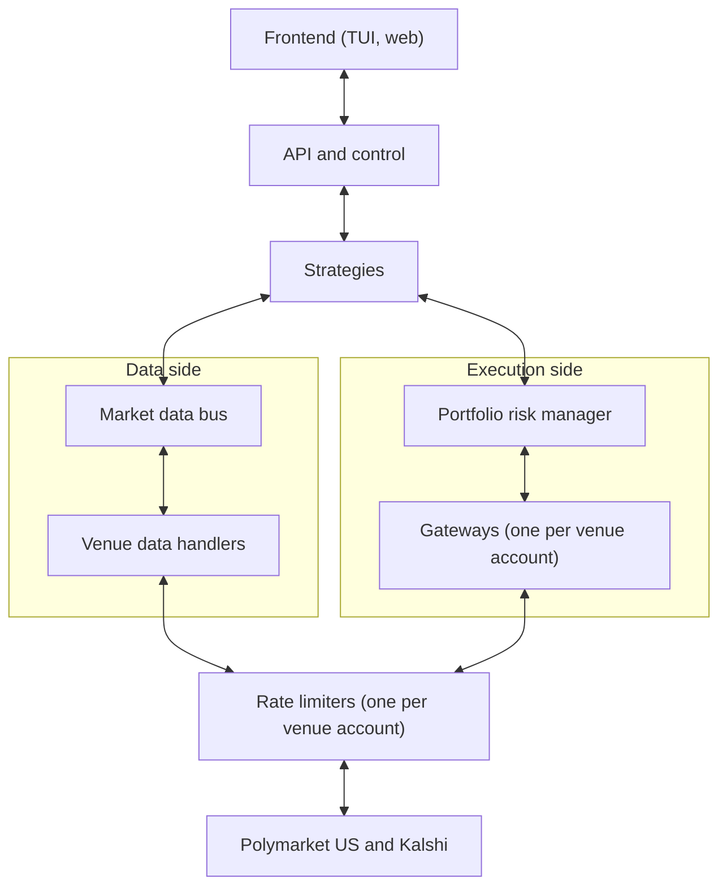
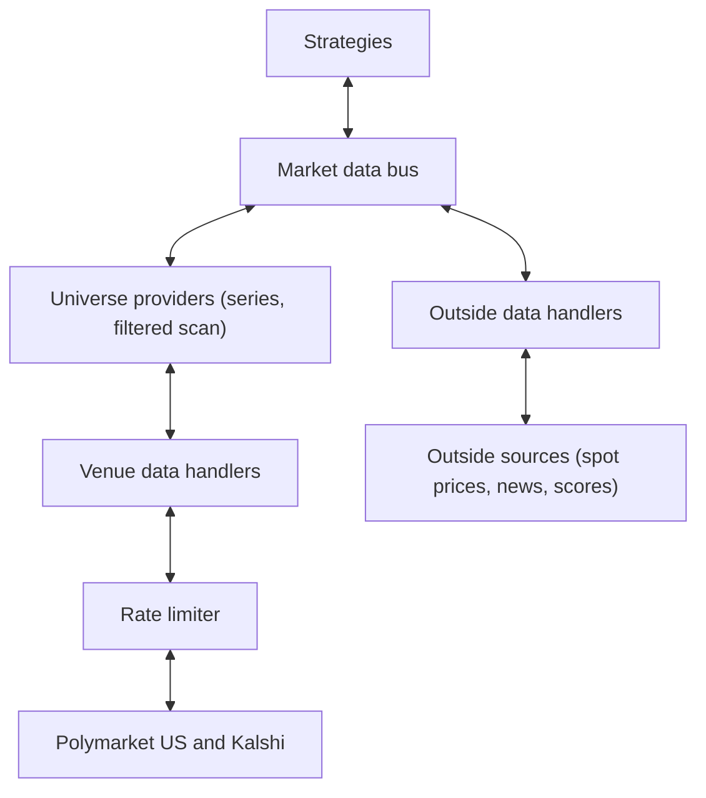
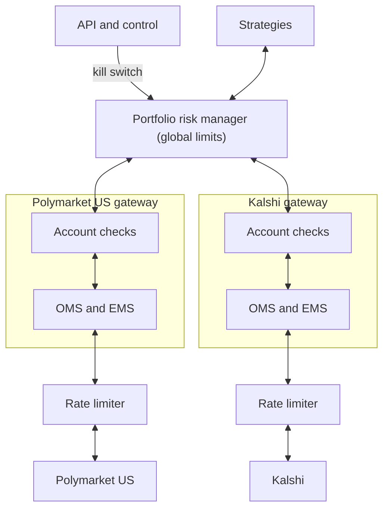
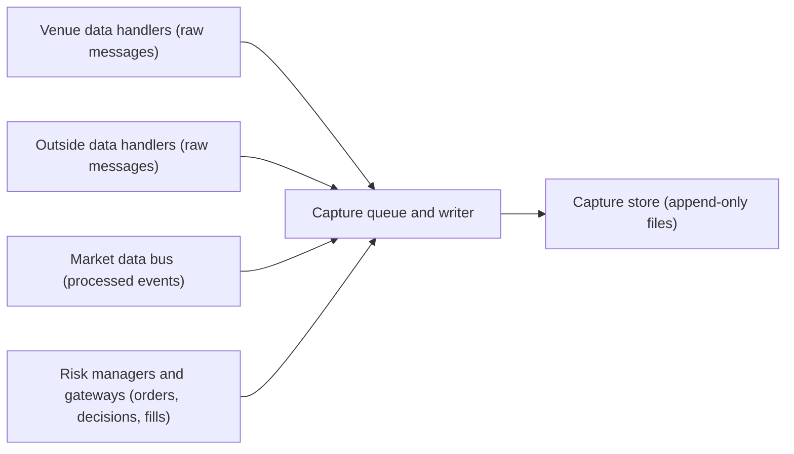
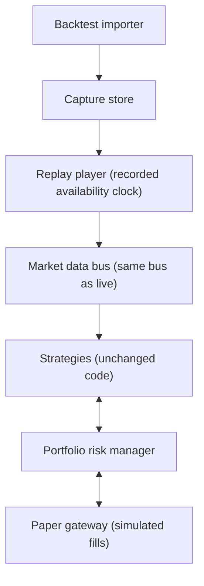
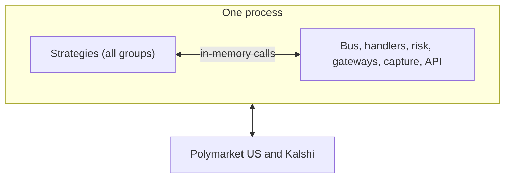
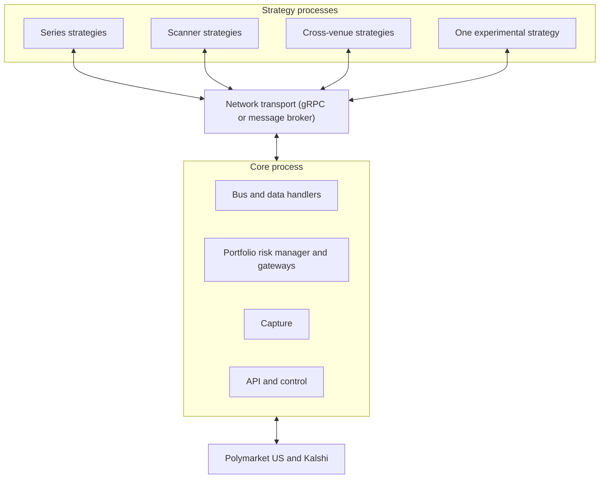

# Prediction market trading bot: architecture

This file describes the target architecture for a trading bot that runs strategies on Polymarket US and Kalshi as the initial v2 venues. Use it as the design reference when refactoring or extending the codebase. Where the current code differs from this file, this file describes the goal.

## Design principles

1. Strategies sit on top of shared layers. A strategy declares what data it needs and what orders it wants. It does not poll APIs or talk to venues.
2. All orders pass through the gateways. Nothing else may call a venue's trading API.
3. The same strategy code runs live, in replay, and in paper mode. Only the data source, the gateway mode, and the clock change.
4. The same strategy code runs in one process or in several. Only the transport between strategies and the shared layers changes.
5. Every order, fill, and PnL record carries a strategy ID. Per-strategy metrics come from that tag.

## System overview

Each diagram below shows one part of the system. This first one shows the layers and nothing else. Strategies split into a data side and an execution side, and both sides reach the venues through the rate limiter.

Events and fills travel up the same lines that requests and orders travel down. Capture, outside data, and the kill switch have their own diagrams below to keep this one readable.

## Data flow and discovery

A strategy declares a universe, which is the set of markets it wants to watch, written as a series name or a set of filters. The bus passes that request to a universe provider. The provider finds the markets and tells the venue data handlers what to fetch. Events then travel back up the same chain. Outside data follows the same pattern on a second branch.

The outside branch does not go through the rate limiter, because limits apply per venue account.

## Order flow

An order request passes the portfolio risk manager first, which checks limits across all accounts. It then passes the account checks inside one gateway, then the OMS and EMS, then the rate limiter, then the venue. Fills and rejections return along the same path, so the portfolio risk manager updates its exposure as they pass.

A cross-venue strategy sends its requests to the portfolio risk manager, which routes each leg to the matching gateway. The kill switch blocks new orders and tells each gateway to cancel the bot's open orders and reconcile submissions already sent.

## Capture

Four sources offer records to a bounded capture queue. A separate writer drains the queue to the capture store. Trading continues if capture falls behind or fails. The OMS still owns the order and position state it needs for execution and reconciliation.

The first capture release supports after-session review with versioned, append-only raw files and a validator.

### Possible storage architecture after the first release

Add Parquet exports when historical analysis needs them. Add the hot store when there is a need to query recent history during a session. The live feed maintains the current order book in memory.

| Layer | Candidate | What it stores |
| --- | --- | --- |
| Metadata | SQLite with one core writer. Consider Postgres if multiple services need to write. | Venue-scoped market and outcome IDs, question text, category, expiration, contract rules, and settlement outcomes or payouts. Keep timestamped revisions so replay can use the terms and settlement information known at the time. |
| Hot | QuestDB | Recent normalized book snapshots, deltas, and trades for queries from dashboards or notebooks. Batch writes on the capture worker and give records stable IDs so retries can be deduplicated. |
| Cold | Apache Parquet | Historical snapshots, deltas, trades, and the metadata and timing needed for backtests. Start with UTC date partitions. Verify exports for sequence coverage and known gaps before deleting hot data. |

Retain the versioned raw messages separately so they can be normalized again. Preserve capture sequence numbers and gap boundaries across exports. After a missing book delta, replay needs a fresh snapshot before it can reconstruct a reliable book again.

## Replay, backtest, and paper mode

In this mode no venue connection exists, so a replay cannot place a real order. A single mode setting switches the data source, the gateway, and the clock together. Do not make these three separate switches.

## Run modes: one process or several

The same code runs in either mode. A config setting selects the transport between strategies and the shared layers.

### One process

Use this for local development, tests, and replays. Strategies and the shared layers call each other through the same interfaces as in multi-process mode, but the calls stay in memory.

### Several processes

Use this to test or tweak one strategy without restarting the others, to isolate a strategy that crashes or uses a lot of CPU, or to deploy strategies independently. Each strategy process connects to a core process over a network transport. Strategy processes never connect to a venue. The core process holds every venue connection, so there is still exactly one rate limiter per venue account.

Every process, including each strategy process, exposes the control API. The TUI connects to any of them.

## Components

| Component | Responsibility |
| --- | --- |
| Strategies | Hold strategy logic. Declare a universe, react to events, send order requests. Strategies are grouped by discovery need when run in several processes: series-based (for example BTC up or down every 15 minutes), scanner-based (paginated scans with filters), and cross-venue (needs both venues). |
| Market data bus | Delivers normalized events to strategies. Accepts universe requests from strategies and routes them to a universe provider. |
| Universe providers | Turn a universe request into a set of markets. One provider walks a series. Another pages through the venue API with filters. Both emit market-added and market-removed events. |
| Venue data handlers | Fetch and stream market data from Polymarket US and Kalshi through the venue adapters. Emit normalized events. |
| Outside data handlers | One handler per outside source. Convert each source into the common event format and publish it on the bus. |
| Portfolio risk manager | One for the whole bot. Enforces limits that span accounts: total exposure, daily loss, locked capital, hedged cross-venue pairs, and exposure to the same event on both venues. Reads positions from every gateway's OMS. Handles the kill switch. |
| Gateway | One per venue account. The only path to that venue's trading API. Contains the account checks and the OMS and EMS. |
| Account checks | Per-account limits: available balance, per-market position limit on that venue, order size, and open order count. |
| OMS and EMS | The OMS tracks order state, positions, PnL, reconciliation after restart, and settlement when markets resolve. The EMS decides how to work an order: passive or aggressive, splitting across price levels, repricing, canceling, and partial fills. Keep these as separate modules with a clear interface. |
| Rate limiter | One per venue account. Counts requests from the venue data handlers and the OMS and EMS together. Gives order and cancel requests priority over data polling. |
| Capture | Records raw venue messages, processed events, and gateway activity. Writes through a bounded queue. |
| Replay player | Reads the capture store, publishes events in recorded strategy delivery order, and advances the clock to each event's recorded availability time. |
| Backtest importer | Converts historical data from other sources into the capture format. It never touches the exchanges. |
| API and control | Exposes state and commands to the frontend. Reads positions and orders from the gateways. Sends the kill switch. |

## Rules the implementation must follow

### Strategies and discovery

- Discovery is a pluggable universe provider interface. A strategy asks for "all markets in series X" or "all markets matching filter Y" and receives market-added and market-removed events. Short-lived series need those lifecycle events because markets open and resolve constantly.
- Strategies receive fills, rejections, and positions from the gateways. They keep no private copy of order state.
- Strategies talk to the rest of the system only through two interfaces, a bus client and a gateway client. They never call each other's code or share variables.
- Cross-venue strategies run in one process and send both legs through the portfolio risk manager.

### Time

- Strategies never read the system clock. They ask a clock object for the time. Live, the clock returns wall time. In replay, it advances to the recorded time each event became available to the strategy.
- Preserve source time and receive time separately. For events delivered to strategies, also record availability time and a delivery sequence. Replay follows that delivery sequence, including for events with equal availability times. A late event becomes visible at its recorded availability time even if its source timestamp is earlier.

### Risk and gateways

- Every order passes the portfolio risk manager, then the account checks, before it reaches the OMS and EMS.
- The portfolio risk manager sees positions for all accounts and all strategies, not one.
- Check limits and reserve global risk capacity atomically before sending an order. Include pending submissions and open orders in exposure. If a submission times out or its outcome is unknown, hold the reservation until a confirmed venue outcome or reconciliation accounts for it. As fills arrive, move filled exposure from the reservation into positions and keep the unfilled portion reserved until it can no longer fill.
- The kill switch rejects new submissions and blocks dispatch of queued orders. Each gateway requests cancellation of the bot's open orders and reconciles submissions already sent. Keep processing late fills and reserving exposure for any quantity that can still fill or whose outcome is unknown.
- Persist the halted state across reconnects and restarts. The control API reports when all gateways have confirmed that outstanding orders are filled, canceled, or rejected. Trading resumes only after that confirmation and an explicit operator reset. Closing existing positions is a separate operator action.
- On startup, each OMS reconciles its records against the venue's open orders and positions before accepting new requests.
- The paper gateway fills orders by walking recorded order book levels. It does not fill at the quoted price, because thin books make quoted-price fills look better than live trading will be.

### Rate limiting

- Only the venue data handlers and the OMS and EMS go through the rate limiter. Outside data handlers do not, because limits are per venue account.
- Limits come from each venue's documentation. Set them in config per venue.

### Capture

- Store raw venue messages as well as normalized events. A normalization bug can then be fixed and old data reprocessed.
- Stamp each record with receive time and a sequence number from the first day, so replays are repeatable. These fields cannot be added to old data later.
- Assign sequence numbers before enqueueing. If the queue fills or the writer fails, report degraded capture, count dropped records, and record affected sequence ranges when storage is available again. Treat an unverified tail as incomplete. Replay validation rejects incomplete ranges by default.
- Write a format version into each file, because the event schema will change.
- Also capture the gateway's accept and reject decisions, not only strategy decisions.
- Decide a retention policy early. Order book updates on active markets add up quickly.

### Outside data

- Keep outside handlers separate from venue handlers. They fail differently and have different limits.
- Emit a staleness event when a source goes quiet, so strategies do not trade on an old value.

### Processes and observability

- The one-process mode is the default. Multi-process mode must work with no change to strategy code.
- Shared pieces, which are the rate limiter, the portfolio risk manager, and the OMS positions, must not assume that all callers share memory. In one-process mode they may skip the network, but they still sit behind the same interface.
- Tag every order, fill, and PnL record with a strategy ID.
- Every process exposes state and accepts commands through the control API. The TUI is a client of that API and does not read another process's terminal.

## Suggested build order

1. Raw capture. Offer each raw venue message to the bounded queue with receive time, sequence number, and format version. Write accepted records off the data feed path. Add a small script that reads the capture and checks for gaps and incomplete runs. Historical order book data cannot be recreated, so this starts first.
2. Define the normalized event schema and the clock interface.
3. Build the market data bus and the universe provider interface. Port the current paginated discovery and the series discovery as two providers. Put the bus and gateway behind a transport interface that is in-memory for now.
4. Build the first v2 gateway for paper trading. Add OMS state, account checks, and simulated execution. Route v2 paper orders through the gateway.
5. Build the portfolio risk manager above the gateways, including atomic exposure reservations and the kill switch.
6. Add live account reconciliation and wire the shared rate limiter into the venue data handlers and gateways. Enable real order routing only after verifying account reconciliation, global risk reservations, the kill switch, and shared venue rate limiting.
7. Add processed-event and gateway capture on top of the raw capture.
8. Add the replay player and the backtest importer.
9. Add the control API and point the TUI at it.
10. Add outside data handlers, starting with a spot price feed for the BTC series strategy.
11. Add multi-process mode: a network transport, a core process, and strategy processes.

## Open questions

- The exact rate limits for each venue account.
- The network transport for multi-process mode: gRPC or a message broker such as Redis.
- Whether the OMS and EMS stay modules in one process or later split into services. Keep them as modules until something forces a split.
- The recovery policy for a cross-venue trade where one leg fills and the other does not: hedge, wait and unwind, or size the trade so the exposure is acceptable.
